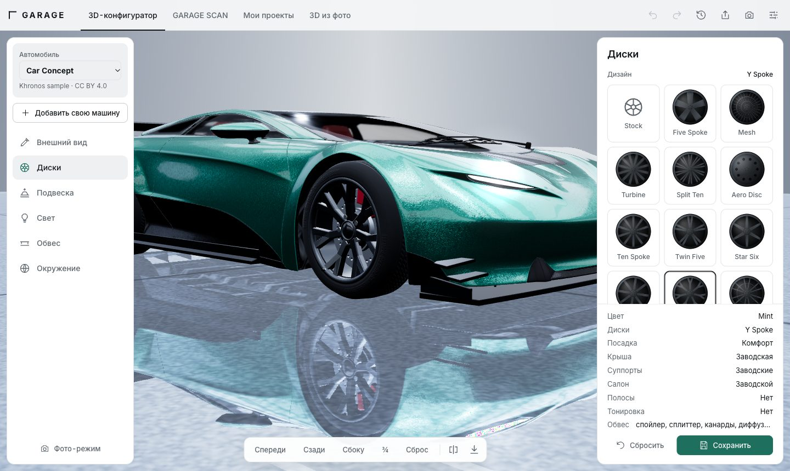
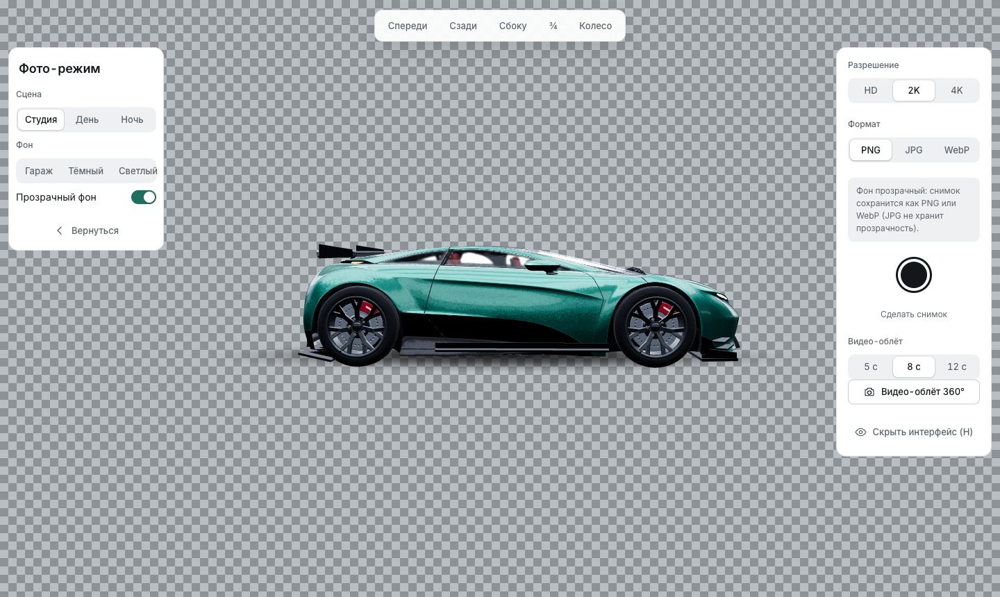

# GARAGE — Built, not bought.




Interactive car studio: **3D GARAGE** (configurator) + **GARAGE SCAN** (photo tuning) + MY GARAGE + PHOTO MODE.

```bash
npm install
npm run dev        # http://localhost:5173
npm run server     # API on :8787 (AI / 3D providers; optional)
npm run build && npm run server   # production: server also serves dist/
```

## Research
`research/fixes.md` — what 2 099 public App Store reviews of competitors (3DTuning, Cartomizer, AI tuning apps…) complain about and how GARAGE answers it. App Store only; sources and limits are stated there.

## UX highlights
Undo/Redo (Ctrl+Z / Ctrl+Shift+Z), change history, autosave (config + photo session), hold-to-compare, dark/light theme, adaptive 3D quality (Auto/High/Medium/Low), mobile bottom sheet with drag gestures, keyboard-accessible controls.

## What really works
- Cinematic intro (GSAP, skippable, `prefers-reduced-motion`), idle camera orbit (toggle in Light).
- 3D scene (R3F): paint colour / metallic / gloss / matte with animated change, 5 wheel designs + colours (animated swap, camera focus),
  ride height + Street/Sport/Show, headlights (real spot lights) / tail lights, Studio/Day/Night, spoiler / splitter / skirts, camera presets.
- GARAGE SCAN: JPG/PNG/WebP upload (gallery, camera, drag&drop, magic-byte validation), manual body selection (colour wand, brush, eraser,
  exclude dark zones, invert), recolour keeping highlights/shadows, hue/sat/brightness/strength, wheel overlay with manual fit,
  BEFORE/AFTER/slider, undo, reset, PNG export, save to MY GARAGE.
- Catalogue wheels are fully procedural (`src/scene/Wheel.tsx`): dished face with raised ribs, hub plate, centre cap, lug nuts, valve stem,
  drilled brake rotor, arc-shaped caliper (coloured by the Calipers zone) and a tyre with generated tread and sidewall lettering (bump map).
  Studio lighting has long side softboxes so flanks get highlight bands; headlight beams are aimed through real target objects.
- Lamps: emissive lens + soft additive halos near the ends of each lamp strip (placed from the real mesh vertices, fade out when the camera is behind the lamp);
  the Light section jumps the camera to the headlights / tail lights. Cabin view looks through the glass; glass has its own reflection strength so the interior reads.
  Studio fill lights are neutral (a tinted fill used to colour the roof and floor mats: a configurator must show true colours).
  Note: in three r186 `material.envMapIntensity` is ignored unless the material has its own `envMap`; `src/scene/envBind.ts` binds the scene environment per material.
- Wheel catalogue: 14 original designs (`src/lib/rims.ts`, shared by the 3D wheel and the photo overlay) built from common archetypes — multi-spoke, twin-spoke, star, blade, Y-spoke, lattice, wide six, fan, classic plate. They are not copies of any manufacturer's wheel.
- Aero kit (`src/scene/Aero.tsx`): profiled parts instead of boxes — splitter with end plates and struts, front canards, side skirt blades, street/race diffuser with fins, lip / ducktail / GT wing / swan-neck wing with end plates and gurney flap.
  **Other bodies:** six low-poly cars from Kenney's CC0 Car Kit (pick in the Car box; only body colour and finish apply — they have one palette texture and no part variants, so no wheel / aero / light swaps). They look toy-like next to Car Concept on purpose: they are the only licence-clean extra bodies found. **Not offered:** real bumpers. The only car model is one piece, and no licence-clean variants were found, so the app does not pretend to have them.
- GARAGE SCAN wheels: click the middle of a wheel and the frame fits itself (`fitWheel` in `src/scan/engine.ts`: rays find the tyre, an ellipse is fitted; black rims on black tyres use the outer tyre edge × 0.74). If the photo is ambiguous it says so and leaves a default frame to adjust by hand. The overlay matches the photo's brightness and casts a soft contact shadow. On a night shot with black rims the fit lands on the wheel but is a few percent off — drag the white handles.
- GARAGE SCAN extras: «Сгладить края» cleans the selection border; «до / после» exports both images in one PNG.
- PHOTO MODE «Прозрачный фон»: the studio, floor and fog are removed and the PNG/WebP keeps an alpha channel (a soft shadow blob grounds the car). JPG cannot hold transparency, so it falls back to PNG. Checked: a 2560×1528 PNG, 87% fully transparent pixels.
- PHOTO MODE «Видео-облёт 360°» (5 / 8 / 12 s): the camera makes exactly one orbit and the 3D canvas is recorded with `MediaRecorder` (MP4 where the browser can, otherwise WebM; no interface in the picture, 10 Mbit/s, resolution capped near 2K). Checked in Chrome: a 4.8 s MP4, 2160×1290, plays and is not black. Video cannot be transparent (the background is black in «Прозрачный фон»). Not tested in Safari or on a phone — the file size follows the screen's pixel density.
- Window tint (none / 70% / 35% / 5% light passing, with the RU 70% front-glass rule shown) — applied to all glass of the model.
- Stripes (twin / wide / side band, 8 colours): drawn by a shader patch on the model's paint materials (`src/scene/livery.ts`) in the car's own frame,
  so they follow the hood, roof and body without textures. The side band is an approximation: it uses the surface normal and a height band.
- Share a build as a link: the config is encoded in the URL fragment (`#build=1.<base64url JSON>`, `src/lib/share.ts`), never sent to a server.
  Every field from a link is validated; the visitor's own build stays one Undo away. Phones use the native share sheet, desktop copies the link.
- Lighthouse (mobile, production build): Accessibility 100, Best Practices 100, SEO 100. Pinch-zoom is allowed; the skip link targets `#main` on every screen.
- Compare two saved 3D projects side by side in MY GARAGE (previews + a table where only the differences are highlighted).
- MY GARAGE: IndexedDB (open / duplicate / delete, previews). PHOTO MODE: hide UI, angles, lighting, background, PNG export.

## Run, build, publish
```bash
npm install
npm run dev        # http://localhost:5173 (Vite)
npm run server     # http://localhost:8787, serves dist/ + the optional AI/3D provider API
npm test           # 18 tests: share links, wheel/car catalogue, wheel auto-fit, recolour (Vitest)
npm run build
npm run deploy     # builds for GitHub Pages and pushes the gh-pages branch
npm run deploy:netlify   # builds for the site root and publishes to https://garage-built-not-bought.netlify.app (needs `npx netlify-cli@20 login` once)
```
**GitHub Pages is static hosting:** everything works (3D, photo editor, projects, share links, offline install), but `/api/*` does not exist there,
so AI TUNING and CREATE 3D show “Требуется настройка AI” instead of faking results. To use them, run `npm run server` with `server/.env`
(see `server/.env.example`) on any Node host.

## Honest limits
- The car is **Car Concept** (Khronos sample asset, CC BY 4.0 — attribution shown in the UI, see `public/models/README.md`). Shipped compressed (meshopt geometry + WebP textures, `npm run models` from `models-src/`):
  `car.glb` 2.8 MB (2048px textures) for desktop, `car-mobile.glb` 2.6 MB (1024px, ~17 MB less VRAM) for weak devices; the original was 11.8 MB.
  The download streams with real byte progress and starts at boot, in parallel with the 3D code. A procedural car is kept as automatic fallback. Bumpers/bodykits are not offered:
  the model has no part variants. Spoiler / splitter / skirts are separate simple meshes placed from the model bounds.
- Auto body selection in GARAGE SCAN: MediaPipe Image Segmenter + DeepLabV3 (Apache-2.0), self-hosted in `public/mediapipe` and
  `public/models/seg` (~7 MB over the network, loaded only when «Авто» is pressed, runs on-device). It finds the car, keeps the largest one,
  drops glass/tyres by darkness; light rims and headlights may stay selected and are fixed with the eraser. Tested on one real photo (white sedan).
  Restore assets after a clean install with `npm run seg:assets`.
- Per-zone colours in 3D: body, roof & inserts (`Paint 2`), brake calipers (`Brake` + catalogue wheels), interior accents (`Interior 3`); null = factory colour.
- Wheel swap on photos is a 2D overlay, not generative. AI TUNING needs `server/.env` (`STABILITY_API_KEY`, Stability AI inpaint);
  without it the UI shows “Требуется настройка AI”. Not tested with a live key.
- CREATE 3D: provider interface in `server/providers/types.js`; **no provider is bundled** — the screen reports it as not configured.
- Not tested on a real iPhone. Checked in Chrome emulation (390×844 @3x, 4× CPU, Slow 4G): car visible in ~15 s (was ~36 s), 60 fps,
  auto quality capped at Medium on phones. `npm run server` serves `dist/` with gzip and correct caching.
